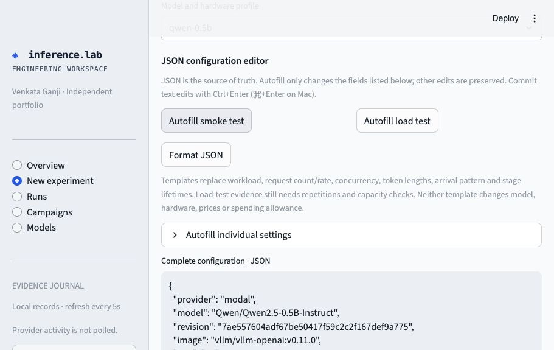
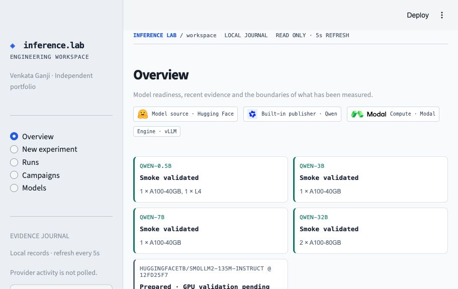
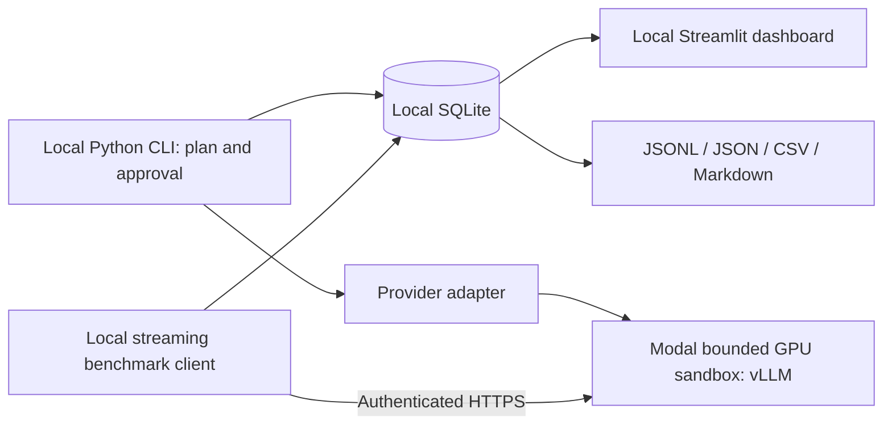

# Inference Lab

**Bring a model. Ask a performance question. Run an experiment you can explain.**

Want to explore inference benchmarking without owning a GPU—or spending your first afternoon wiring together scripts, charts and cloud cleanup? Start with a **free local simulator**, then take a reviewed configuration to **real GPUs on Modal**. Keep the configuration, measurements and evidence together in one local workspace.

| Model source | GPU compute | Built-in model family |
|:---:|:---:|:---:|
| <a href="https://huggingface.co/"></a> | <a href="https://modal.com/"></a> | <a href="https://huggingface.co/Qwen"></a> |
| **Hugging Face** | **Modal** | **Qwen** |

Serving engine: **vLLM** · Dashboard: **Streamlit + Plotly** · Experiment journal: **SQLite**

## Built for curious engineers—and the people leading them

**Engineering manager, inference engineer, or hands-on hobbyist? Start here.** Inference Lab gives you a working place to explore model serving, try configurations and inspect results without building the experiment harness from scratch.

- **Engineering managers:** walk through an experiment with your team and see the settings, results and limits behind a performance claim.
- **Inference engineers:** test a hypothesis, compare configurations and inspect request-level evidence.
- **Hobbyists and learners:** start with the free simulator, learn what the metrics mean, then try a small GPU run when you're ready.

**Get started quickly. Keep your first experiment small. Learn before you scale.** The local demo has no cloud cost; real GPU runs use reviewed spending estimates and bounded lifetimes. Setup time and cost depend on your environment and chosen model.

## What can I do with this?

- **Try the workflow for $0 in cloud spend.** Generate simulated successes, failures and comparisons on your laptop. No GPU or cloud account required.
- **Bring a supported Hugging Face model.** Resolve a pinned revision and check metadata and the analytical memory budget before attempting GPU execution.
- **Turn a question into a configuration.** Use smoke/load autofill or edit JSON to explore request rate, concurrency, token lengths, precision and cache settings.
- **Run a small, deliberate GPU experiment.** Review estimated cost, approve the exact plan and use a bounded resource lifetime with recorded cleanup.
- **See what happened—and what remains unproven.** Inspect latency, throughput, failures, available telemetry and quality-workload scores; export the evidence for review.

**Start small, measure, then decide what to test next.** One development smoke run completed 60 requests on an A100 40GB with an estimated resource cost of **about $0.09**. That is [one observed experiment](docs/smoke-result-2026-11-03.json), not a price guarantee or reconciled invoice. Model size, startup time, workload and hardware change the cost.

[**Try the free demo ↓**](#run-the-free-local-demo) · [**Bring your model →**](docs/bring-your-model.md) · [**See the dashboard ↓**](#dashboard-preview)

Local execution currently means **simulation**, not local GPU model serving. **Modal is the implemented cloud provider**; Superlinked is not integrated. Logos identify project components, not partnerships or endorsements.

## Why I built this

I've spent the last 2.5 years working as an AI infrastructure platform engineer at Apple. I'm also an inference engineering enthusiast—the kind who sees a model running and immediately wants to know: **What happens when we turn up the load? Where does latency start to climb? Can I reproduce that result tomorrow?**

I built Inference Lab for myself: a place to bring a model, test a hypothesis, change a configuration, and keep the evidence. I wanted to see the whole experiment together—model revision, workload, hardware, latency, throughput, failures, and estimated cost—so I could understand what actually changed between runs.

That curiosity became this project. Start with a free local simulation, move to a bounded GPU experiment when you're ready, and inspect the results all the way down to individual requests. A successful run is satisfying. An experiment that teaches you *why* it behaved that way is much more interesting.

I'm sharing it for other engineers who enjoy asking those questions. **Clone it, bring your own hypothesis, and help make the experiments better.**

This is my independent personal project, developed with OpenAI Codex assistance; it is not an Apple product or an account of Apple's internal systems.

**Evidence status:** Qwen2.5 0.5B, 3B, 7B and 32B each completed a 60-request remote smoke test during development. This establishes serving compatibility for those tested configurations, not maximum capacity or model quality. Raw local run journals are not bundled in the public repository. A fresh clone starts empty; the free simulator generates clearly labeled synthetic results. New Hugging Face onboarding is metadata- and locally tested, not yet GPU-validated for a new model family.

**Status: experimental public preview.** Suitable for trying the local demo and bounded,
reviewed experiments. Not a production load generator or independently certified benchmark.

[Getting started & troubleshooting](docs/getting-started.md) ·
[Bring your model](docs/bring-your-model.md) ·
[Validation report](docs/engineering-report.md) ·
[Contributing](CONTRIBUTING.md) · [Apache-2.0](LICENSE)


## Dashboard preview

Development screenshots below show the JSON autofill editor and recorded model readiness.
A fresh clone does **not** include these private local run journals; generate the free demo
or execute your own approved experiment to populate your dashboard.



<details>
<summary>Model readiness screenshot</summary>



</details>

## Run the free local demo

Requires Python 3.12 and [uv](https://docs.astral.sh/uv/) on macOS or Linux. No GPU, CUDA, cloud credentials or Docker needed for the simulator. Native Windows is unsupported (`fcntl` locking).

```sh
git clone https://github.com/offroadguy/inference-lab.git
cd inference-lab
uv sync --frozen
uv run pytest -q
uv run python -m inference_lab.demo
uv run streamlit run src/inference_lab/dashboard.py --server.address=127.0.0.1
```

Open [localhost:8501](http://localhost:8501), then **Runs → Simulated**. The demo runs five **synthetic** experiments: baseline, a concurrency change, higher offered load, injected HTTP 503, and a healthy recovery run. It generates `data/simulated-demo.json` and a report directory per run. This tests the software; its timings and placeholder token counts are **not model or GPU evidence**.

For a single run:

```sh
uv run inference-lab plan --provider simulated --workload chat
uv run inference-lab run RUN_ID
uv run inference-lab report RUN_ID
```

Use the `run_id` printed by `plan`. State and raw measurements stay in ignored `data/`. `LAB_DATA` or `--data` changes the CLI directory; set `LAB_DATA` for the dashboard too.

### Docker Compose

```sh
docker compose up --build -d dashboard
docker compose run --rm --entrypoint python cli -m inference_lab.demo
# Interactive CLI example:
docker compose run --rm cli plan --provider simulated
```

Dashboard port binds to localhost. Only the CLI container reads `.env`. The Docker image build, containerized simulator and dashboard smoke check passed. Native Python was also verified.

## Multi-model evaluation

**Four configured checkpoints:** Qwen2.5-Instruct 0.5B, 3B, 7B and 32B. All are below 100B; serving smoke tests passed on explicit configurations. The dashboard now distinguishes profile configuration, tokenizer preparation and verified remote smoke runs.

- Hashed token-length-controlled workloads, regular/Poisson arrivals and repeated load campaigns.
- Aggregate campaign spending approval, resumable child runs and explicit capacity evidence gates.
- Goodput, scheduling lag, confidence intervals and separate server/device telemetry.
- A 40-case versioned quality suite plus custom JSONL evaluation sets.
- Optional local upstream vLLM cross-check and resource-attributed billing reconciliation.

See the [complete multi-model workflow and validation boundaries](docs/multi-model-evaluation.md).

```sh
uv run inference-lab models
uv run inference-lab plan --profile qwen-3b --config examples/sweep-simulated.json
```

## A cloud run (billable, requires your typed approval)

1. Copy `.env.example` to `.env` and set your Modal token locally, or use Modal's existing local credential store. Do not commit credentials. No Hugging Face token is required for the selected public model.
2. Copy `examples/modal-chat.json` to `experiment.json` (or download a config from New experiment). Verify current [Modal pricing](https://modal.com/pricing), update the rates and `pricing_checked` (maximum age seven days), and choose your limits. Credits and expiry remain unknown unless you independently verify them in your account. Sandbox CPU/memory pricing differs from Function pricing.
3. Review and approve:

```sh
uv run inference-lab preflight --config experiment.json
uv run inference-lab plan --config experiment.json
uv run inference-lab approve RUN_ID
# Type the exact phrase shown, including run ID and maximum USD amount.
uv run inference-lab run RUN_ID
```

`run` deploys, validates readiness, warms up, benchmarks, exports JSON/CSV/Markdown, and attempts teardown even on errors. Approval covers one exact plan and expires after one hour if deployment has not started. Any configuration change requires a new plan/approval. There is no automatic redeployment or paid retry.

Separate commands are also available:

```sh
uv run inference-lab deploy RUN_ID
uv run inference-lab benchmark RUN_ID
uv run inference-lab resume RUN_ID
uv run inference-lab teardown RUN_ID
uv run inference-lab list
```

**`deploy` leaves a billable sandbox running**, bounded by its configured lifetime. `resume` reconciles the named sandbox/ID and preserves recorded attempts; it never replays successful, failed or incomplete requests. If the sandbox has terminated, create a fresh plan. If remote creation was ambiguous, reconciliation must succeed before work can continue. Check the provider workspace if shutdown is unverified. A local process crash does not stop remote billing.

The estimate uses the selected profile’s GPU count, CPU cores and RAM, a 25% compute margin and a separate other-charge allowance. CPU/memory limits and a provider-enforced lifetime bound the resource envelope. It is **not an exact dollar billing cap**: image builds, network, taxes, fees, account rates and credits can differ. No persistent model volume or auto-restarting deployment is created. A sandbox remains billable while idle until terminated or timed out; idle time is included in the plan.

## What is measured

- First content chunk latency (client TTFT), streamed chunk timestamps/gaps, average time per output token, end-to-end latency, interpolated p50/p95/p99 and sample counts.
- Server-reported prompt/output token usage when supplied; unavailable stays null.
- Offered requests, successful requests/sec and output tokens/sec over measured windows, admission rejection, timeouts and errors.
- Readiness/cold-start envelope, separate warm-up requests, periodic available vLLM queue/KV-cache metrics.
- Whole-run resource-cost estimate, per-success and per-million-output-token estimates; provider billing is explicitly unknown.

SSE chunks are not necessarily tokens. Individual server token timestamps and isolated model-loading time remain unavailable. NVIDIA device samples and vLLM request-phase histograms are collected when exposed by a real approved run. The dashboard does not invent them. Raw JSONL preserves measurements; CSV contains request summaries. [Methodology](docs/methodology.md) explains limits and interpretation.

## Scope and architecture



Supported profiles use Qwen2.5-Instruct 0.5B/3B/7B/32B at fixed Hugging Face commits, vLLM 0.11.0, FP16 by default (BF16 selectable) and no quantization. L4 and A100 hardware envelopes are reviewed per profile; 32B uses two 80GB A100s with tensor parallelism. Unsupported combinations fail before provisioning. Local dependencies are locked in `uv.lock`; the server image is version-tagged. The bounded Hugging Face onboarding workflow supports additional dense architecture families through metadata checks; each new model still needs GPU validation. Universal sub-100B compatibility and Superlinked integration are not claimed.

## Engineering evidence

- [Architecture, memory and cost reasoning](docs/architecture.md)
- [Experiment and measurement discipline](docs/methodology.md)
- [Three demonstration protocols and five-minute walkthrough](docs/demo.md)
- [Verified engineering report, limitations and attribution](docs/engineering-report.md)

The implementation was authored with OpenAI Codex assistance for Venkata Ganji. Modal supplies remote compute/lifecycle, vLLM supplies inference, and the Qwen team supplies the model. Personal understanding, operation and real benchmark results must be demonstrated separately. No employer source, internal project material or credentials are included.

### Explicit alternate hardware

`qwen-0.5b-a100` and `qwen-3b-a100` select one A100-40GB instead of L4, preserving model and tokenizer revisions, FP16, CPU and RAM limits. Use `plan --profile` to select them explicitly. Hardware changes produce a new plan fingerprint and require fresh approval; there is no automatic GPU substitution. Dashboard readiness lists the hardware actually validated, separately from the default profile. Timing comparisons across GPU types are not controlled model-only comparisons.

### Dashboard workflow

The console separates Overview, New experiment, Runs, Campaigns and Models. New experiment
supports reviewed profiles, metadata inspection of supported Hugging Face repositories and
existing Plan JSON. Guided load/serving controls and an advanced JSON editor feed the same
preflight validator as the CLI. JSON is the source of truth: smoke/load templates and the
Apply settings button merge only their listed fields, preserving other manual edits. The editor
shows syntax locations and a diff from the starting profile. Changing form values alone does
not alter the JSON. Download your configuration to retain it outside the browser session. Configuration
and preflight downloads do not start compute; workload preparation, approval and execution
remain explicit CLI actions. Pricing assumptions must be reviewed before approval.

Runs has Results, Compare, Lifecycle, Quality and Evidence tabs. Full JSON downloads use the
same portable bundle as CLI exports: run configuration, provenance, telemetry, requests,
events, summary and smoke checks. Historical missing provenance remains visibly missing.
“Smoke validated” requires verified remote identity, a completed benchmark, at least ten
planned requests with every request successful, an intact matching workload manifest,
conformant controlled lengths when applicable and verified cleanup. It is not a capacity
or model-quality qualification. Brand assets identify model source, publisher and compute;
they do not imply endorsement or additional cloud integrations.

## About the author

Built by **Venkata Ganji** as an independent inference infrastructure project,
with OpenAI Codex assistance.

- [LinkedIn — Venkata Sai Ganji](https://www.linkedin.com/in/venkata-sai-ganji-3a30a2a4/)
- [Architecture portfolio](https://offroadguy.github.io/)
- [GitHub](https://github.com/offroadguy)

For project questions and reproducible bugs, [open an issue](https://github.com/offroadguy/inference-lab/issues).

## License

Copyright 2026 Venkata Ganji. Project code and documentation are licensed under
[Apache-2.0](LICENSE). Dependencies, model weights, tokenizers and brand assets
retain their respective licenses and trademark rights; see [NOTICE](NOTICE).
