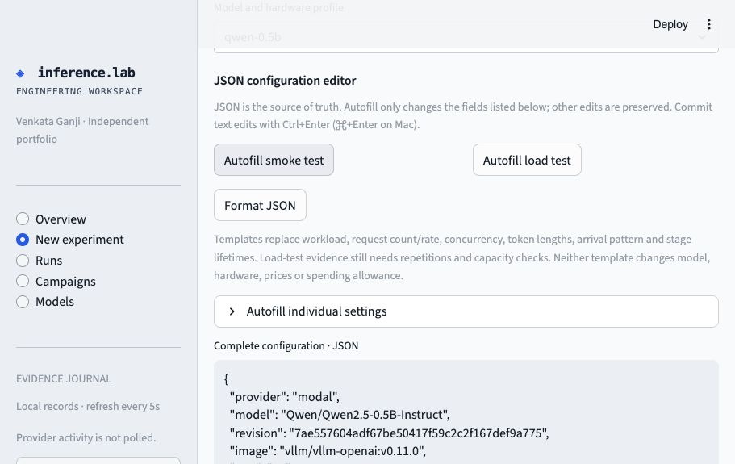

# First run and dashboard walkthrough

## 1. Start without a cloud account

Install Python 3.12 and [uv](https://docs.astral.sh/uv/getting-started/installation/).
Use macOS or Linux. Native Windows is unsupported (`fcntl` locking); WSL2 is an
untested alternative. No CUDA, local GPU, Docker or API key is needed for this demo.

```sh
git clone https://github.com/offroadguy/inference-lab.git
cd inference-lab
uv sync --frozen
uv run python -m inference_lab.demo
uv run streamlit run src/inference_lab/dashboard.py --server.address=127.0.0.1
```

Open [localhost:8501](http://localhost:8501). Keep the terminal running.
Go to **Runs → Simulated**. You should see five recorded synthetic experiments,
including an injected HTTP 503 failure. These demonstrate the software, not GPU performance.
The Overview's remote results will remain empty until you execute a Modal run.

## 2. Read the results

- **Overview:** latest remote record per model/hardware, including failed or planned runs;
  model readiness and the latest validated smoke run. This is not a model ranking.
- **Runs:** choose a run, then Results, Compare, Lifecycle, Quality or Evidence.
  Start with success counts, p95 latency, evidence status and cleanup. Inspect
  the configuration before comparing timings.
- **Campaigns:** repeated load sweeps exported by the CLI. Empty on the free demo.
- **Models:** built-in and locally prepared model readiness. Metadata checks do not
  mean GPU compatibility has been demonstrated.

Missing device/quality/billing measurements remain unavailable. A successful smoke
run does not automatically pass the separate capacity gates.

## 3. Edit a configuration without starting compute

Open **New experiment** and choose a reviewed profile, supported Hugging Face
repository, or existing Plan JSON. Repository inspection downloads metadata, not weights.

1. Choose **Autofill smoke test** for a short token workload, or **Autofill load test**
   for a longer candidate run. Neither proves capacity by itself.
2. Edit the JSON directly. Commit the edit with Ctrl+Enter / Cmd+Enter or blur the field.
3. Alternatively expand **Autofill individual settings**, change values and click
   **Apply settings to JSON**. Only the displayed fields are replaced. Other JSON
   edits survive. Changing form values alone does not change the plan.
4. Inspect **Changes from selected profile** and **Preflight review**.
5. Download the configuration and preflight evidence. Browser drafts are not durable
   storage: download before reloading or leaving the session.

Syntax errors report line/column. Invalid plans have no validated download buttons.
If configuration validation fails, use the CLI preflight locally for detailed diagnostics.
The editor supports formatting and templates, not IDE-style schema autocomplete.



## 4. Run on your own Modal account

Cloud execution is billable. Set local credentials using your Modal credential store
or `.env.example` copied to `.env`. Do not paste secrets into JSON or commit them.
Review your account, current rates, `pricing_checked`, stage lifetimes and spending allowance.
Save the downloaded file as `experiment.json` in the repository root, then:

```sh
uv run inference-lab preflight --config experiment.json
uv run inference-lab plan --config experiment.json
uv run inference-lab approve RUN_ID
uv run inference-lab run RUN_ID
uv run inference-lab report RUN_ID
```

Replace `RUN_ID` with the ID printed by `plan`; approval asks for an exact phrase.
`run` performs deployment through cleanup. Check **Lifecycle** for verified shutdown.
The app prepares configs but does not start cloud execution from the dashboard.
The spending estimate is not a provider billing cap.

For a new model, see [bring your model](bring-your-model.md). For repetitions and
load sweeps, see [multi-model evaluation](multi-model-evaluation.md).

## Troubleshooting

| Symptom | Action |
|---|---|
| Empty Runs page | Select Simulated after running the demo; ensure CLI and dashboard use the same `LAB_DATA`. |
| Port 8501 is busy | Add `--server.port=8502` to Streamlit and open that port. |
| Price date rejected | Review current Modal rates and update `pricing_checked`; do not merely change the date without checking rates. |
| No validated download | Fix JSON syntax or config constraints; inspect `preflight` output locally. |
| GPU never becomes ready | Review the preserved partial run and provider logs; a timeout alone does not identify quota, credit or OOM causes. |
| Shutdown unverified | Run `uv run inference-lab teardown RUN_ID` and independently inspect Modal. |
| Resume refuses a terminated run | Create and approve a fresh plan. Recorded attempts are not replayed. |

The dashboard refreshes the **local journal**, not the Modal account. `deploy` alone
leaves a billable sandbox running; prefer `run` for an end-to-end experiment.
